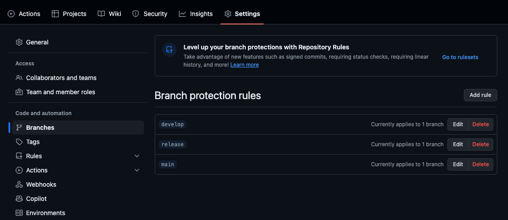
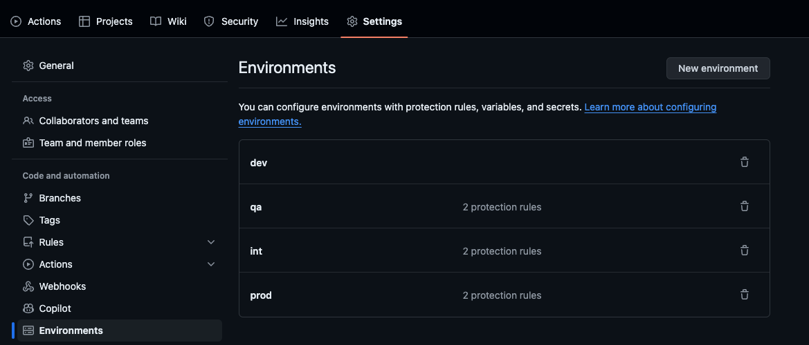

# GitLab Migration Guide for OCWP Services

## Prerequisites

This guide assumes that you have already ran the Gitlab Migration Template on the ODIN Portal.

## Steps

1. In GitHub, update the default branch to the branch of your choice.
2. Clone your newly created GitHub repository.
3. Clone the `migration` branch of the [platform_ocwp](https://github.com/capitecbankltd/platform_ocwp) repository.
4. Make a temporary back-up of each repo in case you accidentally move or delete something you want to undo later. This can be deleted after.
5. Delete everything except the `src` and `.git` folder from your migrated project.
6. Copy everything, except the `.git` folder, from the [platform_ocwp](https://github.com/capitecbankltd/platform_ocwp) repository into the migrated project.
7. Use the codebase of the migrated project in GitHub web to:
   - Add local dependencies to package.json (optional).
   - Copy platform.json (always) and ProjectManifest.json (if Platform-CLI based).
8. Change the ports to 8080.
9. Commit the changes to the default branch.
10. Run npm install.
11. Run ./ocwp-legacy restore to restore all package dependencies.
12. Run ./ocwp-legacy build to test building the project.
13. The workflow on GitHub is tailored to work with a develop and release branch, where the develop branch is the default branch. It also uses the dev, int, qa and prod environments to add rules for deployments. You can either set up these branches and environments using the settings option on GitHub, or choose to modify the workflow file to remove these conditions. You can look at any service in the Capitec repo as an example. Navigate to Settings → Branches, Environments:

11. If the build is successful, navigate to GitHub actions on the web and run the workflow to build and deploy the service to DEV.
12. Sync the project on Argo.

**Note**: You can run ./ocwp-legacy to see all the available commands for platform. All of these commands should still work with this open source version of OCWP.
